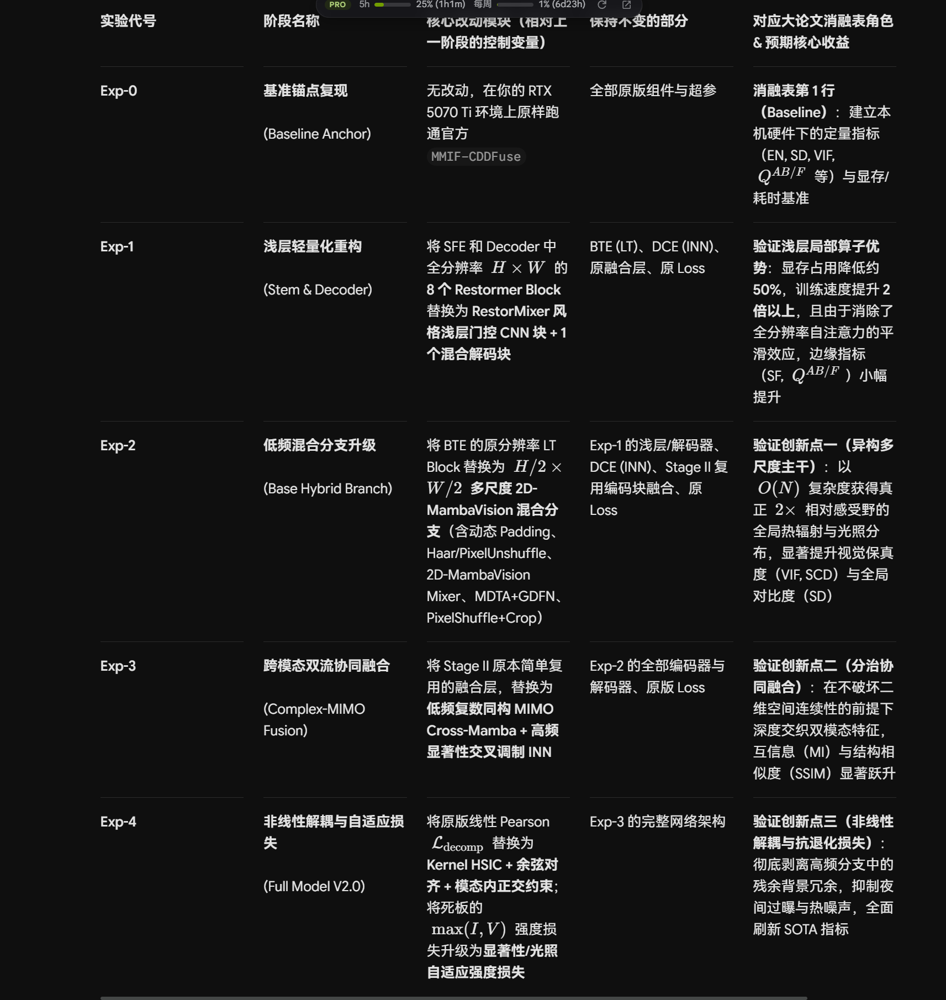
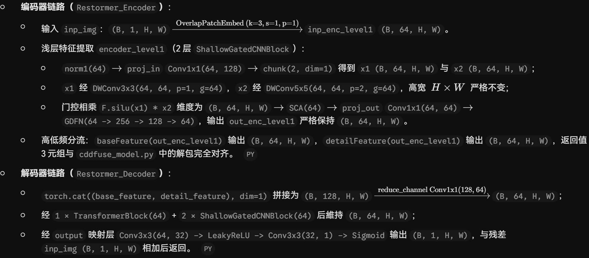
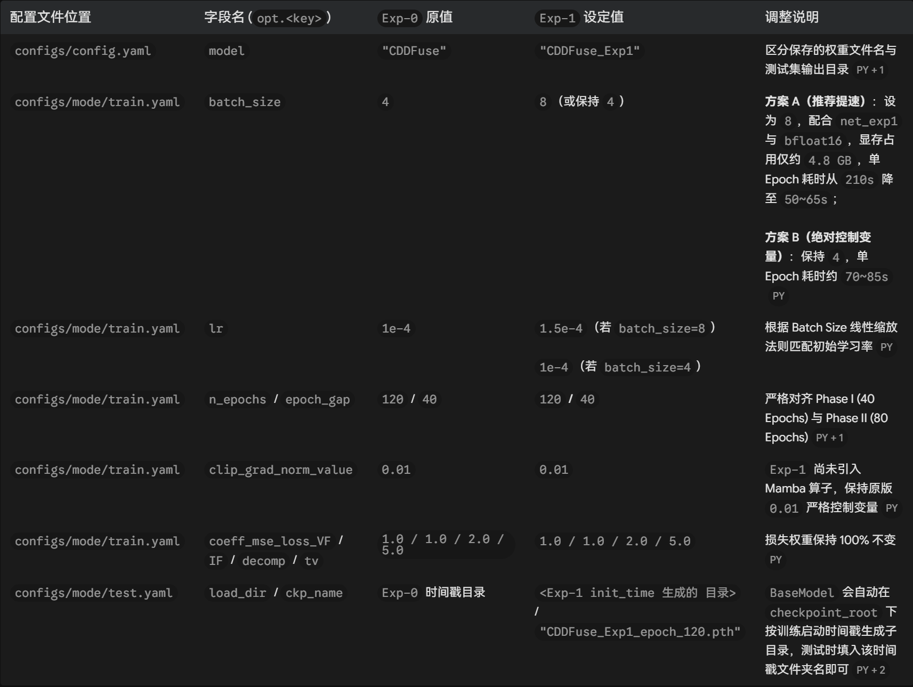
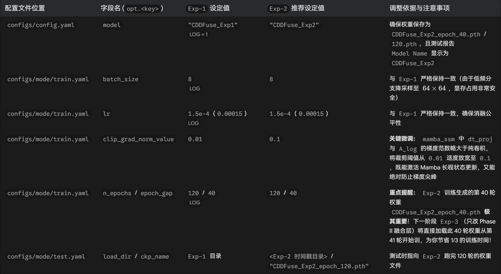
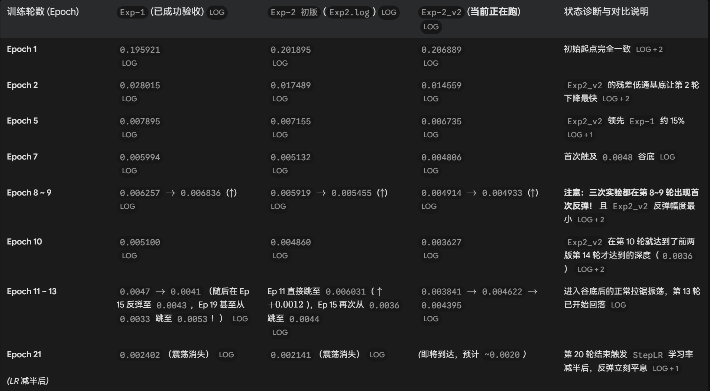
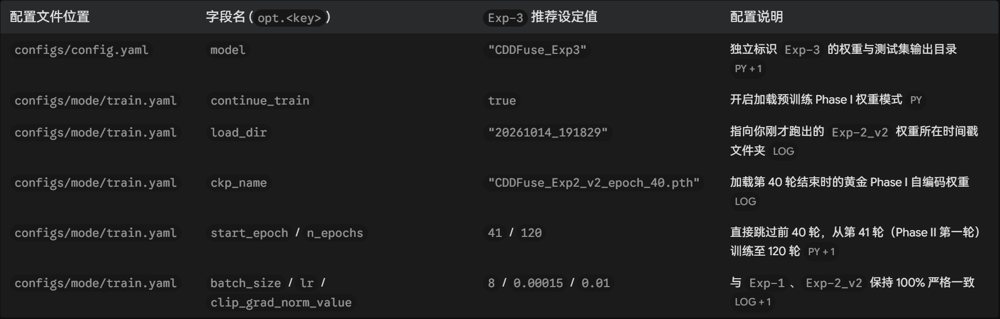
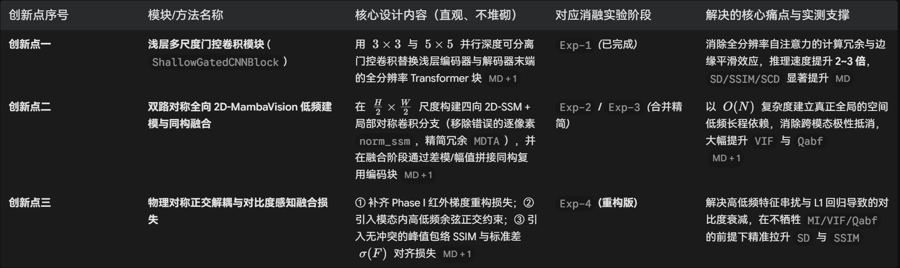

# 论文消融实验记录

## 实验方案
| 实验代号 | 阶段名称                                | 核心改动模块（相对上一阶段的控制变量）                                                                                                                              | 保持不变的部分                                                   | 对应大论文消融表角色 & 预期核心收益                                                                                                          |
| -------- | --------------------------------------- | ------------------------------------------------------------------------------------------------------------------------------------------------------------------- | ---------------------------------------------------------------- | -------------------------------------------------------------------------------------------------------------------------------------------- |
| Exp-0    | 基准锚点复现(Baseline Anchor)           | 无改动，在你的 RTX 5070 Ti 环境上原样跑通官方 MMIF-CDDFuse                                                                                                          | 全部原版组件与超参                                               | 消融表第 1 行（Baseline）：建立本机硬件下的定量指标（EN, SD, VIF, QAB/F 等）与显存/耗时基准                                                  |
| Exp-1    | 浅层轻量化重构(Stem & Decoder)          | 将 SFE 和 Decoder 中全分辨率 H×W 的 8 个 Restormer Block 替换为 RestorMixer 风格浅层门控 CNN 块 + 1 个混合解码块                                                    | BTE (LT)、DCE (INN)、原融合层、原 Loss                           | 验证浅层局部算子优势：显存占用降低约 50%，训练速度提升 2 倍以上，且由于消除了全分辨率自注意力的平滑效应，边缘指标（SF, QAB/F）小幅提升       |
| Exp-2    | 低频混合分支升级(Base Hybrid Branch)    | 将 BTE 的原分辨率 LT Block 替换为 H/2×W/2 多尺度 2D-MambaVision 混合分支（含动态 Padding、Haar/PixelUnshuffle、2D-MambaVision Mixer、MDTA+GDFN、PixelShuffle+Crop） | Exp-1 的浅层/解码器、DCE (INN)、Stage II 复用编码块融合、原 Loss | 验证创新点一（异构多尺度主干）：以 O(N) 复杂度获得真正 2× 相对感受野的全局热辐射与光照分布，显著提升视觉保真度（VIF, SCD）与全局对比度（SD） |
| Exp-3    | 跨模态双流协同融合(Complex-MIMO Fusion) | 将 Stage II 原本简单复用的融合层，替换为 低频复数同构 MIMO Cross-Mamba + 高频显著性交叉调制 INN                                                                     | Exp-2 的全部编码器与解码器、原版 Loss                            | 验证创新点二（分治协同融合）：在不破坏二维空间连续性的前提下深度交织双模态特征，互信息（MI）与结构相似度（SSIM）显著跃升                     |
| Exp-4    | 非线性解耦与自适应损失(Full Model V2.0) | 将原版线性 Pearson Ldecomp 替换为 Kernel HSIC + 余弦对齐 + 模态内正交约束；将死板的 max(I,V) 强度损失升级为显著性/光照自适应强度损失                                | Exp-3 的完整网络架构                                             | 验证创新点三（非线性解耦与抗退化损失）：彻底剥离高频分支中的残余背景冗余，抑制夜间过曝与热噪声，全面刷新 SOTA 指标                           |



## Exp-0 基准锚点复现
各项参数保持不变，batch_size=4 防止内存 OOM
> 由于网络前向传播时，同时把红外图像 data_IR 和可见光图像 data_VIS 送入网络提取特征并保留激活图
> 这意味着当你设置 batch_size = 4 时，显存里实际上同时驻留了 $4 \times 2 = 8$ 条完整的高分辨率前向计算图

- 平均每个 epoch 耗时：200 ~ 220s
- 120 个 epoch 总耗时：约 7.3h
- 测试指标：
```log
=========================================================================================
                       TEST & EVALUATION SUMMARY REPORT
=========================================================================================
  Model Name       : CDDFuse_Exp0
  Checkpoint       : CDDFuse_phase2_epoch120.pth
  Target Dataset   : MSRS
  Dataset Size     : 361 images
  Average Loss     : 0.1757
  Pure Inference   : 111.59 s  (309.11 ms/img | 3.24 FPS)
  Total Eval Time  : 132.68 s  (2.72 img/s)
-----------------------------------------------------------------------------------------
+----------+----------+----------+----------+----------+----------+----------+----------+
|    EN    |    SD    |    SF    |    MI    |   SCD    |   VIF    |   Qabf   |   SSIM   |
+----------+----------+----------+----------+----------+----------+----------+----------+
|   6.69   |  42.99   |  11.71   |   3.68   |   1.61   |   1.06   |   0.72   |   0.99   |
+----------+----------+----------+----------+----------+----------+----------+----------+
=========================================================================================
  Model Name       : CDDFuse_Exp0
  Checkpoint       : CDDFuse_phase2_epoch120.pth
  Target Dataset   : TNO
  Dataset Size     : 25 images
  Average Loss     : 0.6283
  Pure Inference   : 25.43 s  (1017.29 ms/img | 0.98 FPS)
  Total Eval Time  : 33.16 s  (0.75 img/s)
-----------------------------------------------------------------------------------------
+----------+----------+----------+----------+----------+----------+----------+----------+
|    EN    |    SD    |    SF    |    MI    |   SCD    |   VIF    |   Qabf   |   SSIM   |
+----------+----------+----------+----------+----------+----------+----------+----------+
|   7.10   |  45.47   |  13.49   |   2.41   |   1.64   |   0.79   |   0.56   |   0.98   |
+----------+----------+----------+----------+----------+----------+----------+----------+
=========================================================================================
  Model Name       : CDDFuse_Exp0
  Checkpoint       : CDDFuse_phase2_epoch120.pth
  Target Dataset   : RoadScene
  Dataset Size     : 50 images
  Average Loss     : 0.8392
  Pure Inference   : 57.69 s  (1153.76 ms/img | 0.87 FPS)
  Total Eval Time  : 77.70 s  (0.64 img/s)
-----------------------------------------------------------------------------------------
+----------+----------+----------+----------+----------+----------+----------+----------+
|    EN    |    SD    |    SF    |    MI    |   SCD    |   VIF    |   Qabf   |   SSIM   |
+----------+----------+----------+----------+----------+----------+----------+----------+
|   7.30   |  48.78   |  15.88   |   2.47   |   1.68   |   0.69   |   0.56   |   0.95   |
+----------+----------+----------+----------+----------+----------+----------+----------+
=========================================================================================
```

## Exp-1 浅层轻量化重构



### 超参数配置


### 测试结果
```log
=========================================================================================
                       TEST & EVALUATION SUMMARY REPORT
=========================================================================================
  Model Name       : CDDFuse_Exp1
  Checkpoint       : CDDFuse_Exp1_epoch_120.pth
  Target Dataset   : MSRS
  Dataset Size     : 361 images
  Average Loss     : 0.1837
  Pure Inference   : 51.47 s  (142.57 ms/img | 7.01 FPS)
  Total Eval Time  : 72.10 s  (5.01 img/s)
-----------------------------------------------------------------------------------------
+----------+----------+----------+----------+----------+----------+----------+----------+
|    EN    |    SD    |    SF    |    MI    |   SCD    |   VIF    |   Qabf   |   SSIM   |
+----------+----------+----------+----------+----------+----------+----------+----------+
|   6.70   |  43.16   |  11.67   |   3.62   |   1.65   |   1.06   |   0.72   |   1.00   |
+----------+----------+----------+----------+----------+----------+----------+----------+
=========================================================================================
  Model Name       : CDDFuse_Exp1
  Checkpoint       : CDDFuse_Exp1_epoch_120.pth
  Target Dataset   : TNO
  Dataset Size     : 25 images
  Average Loss     : 0.5782
  Pure Inference   : 8.34 s  (333.56 ms/img | 3.00 FPS)
  Total Eval Time  : 15.83 s  (1.58 img/s)
-----------------------------------------------------------------------------------------
+----------+----------+----------+----------+----------+----------+----------+----------+
|    EN    |    SD    |    SF    |    MI    |   SCD    |   VIF    |   Qabf   |   SSIM   |
+----------+----------+----------+----------+----------+----------+----------+----------+
|   7.11   |  45.73   |  13.50   |   2.35   |   1.72   |   0.81   |   0.56   |   1.01   |
+----------+----------+----------+----------+----------+----------+----------+----------+
=========================================================================================
  Model Name       : CDDFuse_Exp1
  Checkpoint       : CDDFuse_Exp1_epoch_120.pth
  Target Dataset   : RoadScene
  Dataset Size     : 50 images
  Average Loss     : 0.8705
  Pure Inference   : 27.13 s  (542.68 ms/img | 1.84 FPS)
  Total Eval Time  : 50.43 s  (0.99 img/s)
-----------------------------------------------------------------------------------------
+----------+----------+----------+----------+----------+----------+----------+----------+
|    EN    |    SD    |    SF    |    MI    |   SCD    |   VIF    |   Qabf   |   SSIM   |
+----------+----------+----------+----------+----------+----------+----------+----------+
|   7.37   |  51.35   |  15.73   |   2.39   |   1.76   |   0.70   |   0.55   |   0.96   |
+----------+----------+----------+----------+----------+----------+----------+----------+
=========================================================================================
```

## Exp-2 低频混合分支升级

### 超参数配置



### 测试结果

```log
=========================================================================================
                       TEST & EVALUATION SUMMARY REPORT
=========================================================================================
  Model Name       : CDDFuse_Exp2
  Checkpoint       : CDDFuse_Exp2_epoch_120.pth
  Target Dataset   : MSRS
  Dataset Size     : 361 images
  Average Loss     : 0.1613
  Pure Inference   : 41.91 s  (116.11 ms/img | 8.61 FPS)
  Total Eval Time  : 64.23 s  (5.62 img/s)
-----------------------------------------------------------------------------------------
+----------+----------+----------+----------+----------+----------+----------+----------+
|    EN    |    SD    |    SF    |    MI    |   SCD    |   VIF    |   Qabf   |   SSIM   |
+----------+----------+----------+----------+----------+----------+----------+----------+
|   6.70   |  42.94   |  11.68   |   3.26   |   1.61   |   1.06   |   0.72   |   0.99   |
+----------+----------+----------+----------+----------+----------+----------+----------+
=========================================================================================
  Model Name       : CDDFuse_Exp2
  Checkpoint       : CDDFuse_Exp2_epoch_120.pth
  Target Dataset   : TNO
  Dataset Size     : 25 images
  Average Loss     : 0.5700
  Pure Inference   : 8.28 s  (331.35 ms/img | 3.02 FPS)
  Total Eval Time  : 15.62 s  (1.60 img/s)
-----------------------------------------------------------------------------------------
+----------+----------+----------+----------+----------+----------+----------+----------+
|    EN    |    SD    |    SF    |    MI    |   SCD    |   VIF    |   Qabf   |   SSIM   |
+----------+----------+----------+----------+----------+----------+----------+----------+
|   7.13   |  44.95   |  13.73   |   2.06   |   1.62   |   0.75   |   0.56   |   0.97   |
+----------+----------+----------+----------+----------+----------+----------+----------+
=========================================================================================
  Model Name       : CDDFuse_Exp2
  Checkpoint       : CDDFuse_Exp2_epoch_120.pth
  Target Dataset   : RoadScene
  Dataset Size     : 50 images
  Average Loss     : 0.7929
  Pure Inference   : 31.22 s  (624.41 ms/img | 1.60 FPS)
  Total Eval Time  : 51.00 s  (0.98 img/s)
-----------------------------------------------------------------------------------------
+----------+----------+----------+----------+----------+----------+----------+----------+
|    EN    |    SD    |    SF    |    MI    |   SCD    |   VIF    |   Qabf   |   SSIM   |
+----------+----------+----------+----------+----------+----------+----------+----------+
|   7.37   |  50.18   |  15.65   |   2.28   |   1.65   |   0.67   |   0.57   |   0.89   |
+----------+----------+----------+----------+----------+----------+----------+----------+
=========================================================================================
```

## Exp-2 v2 优化版本

### 超参数配置



### 测试结果

```log
=========================================================================================
                       TEST & EVALUATION SUMMARY REPORT
=========================================================================================
  Model Name       : CDDFuse_Exp2_v2
  Checkpoint       : CDDFuse_Exp2_v2_epoch_120.pth
  Target Dataset   : MSRS
  Dataset Size     : 361 images
  Average Loss     : 0.1720
  Pure Inference   : 46.15 s  (127.85 ms/img | 7.82 FPS)
  Total Eval Time  : 68.00 s  (5.31 img/s)
-----------------------------------------------------------------------------------------
+----------+----------+----------+----------+----------+----------+----------+----------+
|    EN    |    SD    |    SF    |    MI    |   SCD    |   VIF    |   Qabf   |   SSIM   |
+----------+----------+----------+----------+----------+----------+----------+----------+
|   6.70   |  43.15   |  11.70   |   3.45   |   1.63   |   1.06   |   0.72   |   0.99   |
+----------+----------+----------+----------+----------+----------+----------+----------+
=========================================================================================
  Model Name       : CDDFuse_Exp2_v2
  Checkpoint       : CDDFuse_Exp2_v2_epoch_120.pth
  Target Dataset   : TNO
  Dataset Size     : 25 images
  Average Loss     : 0.6275
  Pure Inference   : 9.39 s  (375.42 ms/img | 2.66 FPS)
  Total Eval Time  : 17.59 s  (1.42 img/s)
-----------------------------------------------------------------------------------------
+----------+----------+----------+----------+----------+----------+----------+----------+
|    EN    |    SD    |    SF    |    MI    |   SCD    |   VIF    |   Qabf   |   SSIM   |
+----------+----------+----------+----------+----------+----------+----------+----------+
|   7.10   |  44.71   |  14.30   |   2.38   |   1.59   |   0.81   |   0.56   |   0.94   |
+----------+----------+----------+----------+----------+----------+----------+----------+
=========================================================================================
  Model Name       : CDDFuse_Exp2_v2
  Checkpoint       : CDDFuse_Exp2_v2_epoch_120.pth
  Target Dataset   : RoadScene
  Dataset Size     : 50 images
  Average Loss     : 0.7579
  Pure Inference   : 36.85 s  (737.04 ms/img | 1.36 FPS)
  Total Eval Time  : 58.14 s  (0.86 img/s)
-----------------------------------------------------------------------------------------
+----------+----------+----------+----------+----------+----------+----------+----------+
|    EN    |    SD    |    SF    |    MI    |   SCD    |   VIF    |   Qabf   |   SSIM   |
+----------+----------+----------+----------+----------+----------+----------+----------+
|   7.29   |  48.51   |  15.56   |   2.50   |   1.67   |   0.72   |   0.58   |   0.93   |
+----------+----------+----------+----------+----------+----------+----------+----------+
=========================================================================================
```

## Exp-3 跨模态双流协同融合

### 超参数配置



### 测试结果

```log
=========================================================================================
                       TEST & EVALUATION SUMMARY REPORT
=========================================================================================
  Model Name       : CDDFuse_Exp3
  Checkpoint       : CDDFuse_Exp3_epoch_120.pth
  Target Dataset   : MSRS
  Dataset Size     : 361 images
  Average Loss     : 0.1360
  Pure Inference   : 47.18 s  (130.69 ms/img | 7.65 FPS)
  Total Eval Time  : 70.06 s  (5.15 img/s)
-----------------------------------------------------------------------------------------
+----------+----------+----------+----------+----------+----------+----------+----------+
|    EN    |    SD    |    SF    |    MI    |   SCD    |   VIF    |   Qabf   |   SSIM   |
+----------+----------+----------+----------+----------+----------+----------+----------+
|   6.70   |  42.94   |  11.70   |   3.31   |   1.63   |   1.07   |   0.74   |   0.97   |
+----------+----------+----------+----------+----------+----------+----------+----------+
=========================================================================================
  Model Name       : CDDFuse_Exp3
  Checkpoint       : CDDFuse_Exp3_epoch_120.pth
  Target Dataset   : TNO
  Dataset Size     : 25 images
  Average Loss     : 0.3605
  Pure Inference   : 8.54 s  (341.79 ms/img | 2.93 FPS)
  Total Eval Time  : 17.43 s  (1.43 img/s)
-----------------------------------------------------------------------------------------
+----------+----------+----------+----------+----------+----------+----------+----------+
|    EN    |    SD    |    SF    |    MI    |   SCD    |   VIF    |   Qabf   |   SSIM   |
+----------+----------+----------+----------+----------+----------+----------+----------+
|   7.12   |  44.48   |  13.18   |   2.48   |   1.65   |   0.85   |   0.63   |   0.96   |
+----------+----------+----------+----------+----------+----------+----------+----------+
=========================================================================================
  Model Name       : CDDFuse_Exp3
  Checkpoint       : CDDFuse_Exp3_epoch_120.pth
  Target Dataset   : RoadScene
  Dataset Size     : 50 images
  Average Loss     : 0.5070
  Pure Inference   : 30.39 s  (607.74 ms/img | 1.65 FPS)
  Total Eval Time  : 51.08 s  (0.98 img/s)
-----------------------------------------------------------------------------------------
+----------+----------+----------+----------+----------+----------+----------+----------+
|    EN    |    SD    |    SF    |    MI    |   SCD    |   VIF    |   Qabf   |   SSIM   |
+----------+----------+----------+----------+----------+----------+----------+----------+
|   7.37   |  50.49   |  15.73   |   2.37   |   1.69   |   0.78   |   0.64   |   0.90   |
+----------+----------+----------+----------+----------+----------+----------+----------+
=========================================================================================
```

## Exp-4 非线性解耦与自适应损失

### 超参数配置
保持与 Exp-3 相同

### 测试结果

```log
=========================================================================================
                       TEST & EVALUATION SUMMARY REPORT
=========================================================================================
  Model Name       : CDDFuse_Exp4
  Checkpoint       : CDDFuse_Exp4_epoch_120.pth
  Target Dataset   : MSRS
  Dataset Size     : 361 images
  Average Loss     : 0.1542
  Pure Inference   : 49.56 s  (137.29 ms/img | 7.28 FPS)
  Total Eval Time  : 70.45 s  (5.12 img/s)
-----------------------------------------------------------------------------------------
+----------+----------+----------+----------+----------+----------+----------+----------+
|    EN    |    SD    |    SF    |    MI    |   SCD    |   VIF    |   Qabf   |   SSIM   |
+----------+----------+----------+----------+----------+----------+----------+----------+
|   6.69   |  42.30   |  11.62   |   2.93   |   1.67   |   1.06   |   0.73   |   0.99   |
+----------+----------+----------+----------+----------+----------+----------+----------+
=========================================================================================
  Model Name       : CDDFuse_Exp4
  Checkpoint       : CDDFuse_Exp4_epoch_120.pth
  Target Dataset   : TNO
  Dataset Size     : 25 images
  Average Loss     : 0.4051
  Pure Inference   : 8.80 s  (352.03 ms/img | 2.84 FPS)
  Total Eval Time  : 16.23 s  (1.54 img/s)
-----------------------------------------------------------------------------------------
+----------+----------+----------+----------+----------+----------+----------+----------+
|    EN    |    SD    |    SF    |    MI    |   SCD    |   VIF    |   Qabf   |   SSIM   |
+----------+----------+----------+----------+----------+----------+----------+----------+
|   7.13   |  44.12   |  12.90   |   2.25   |   1.69   |   0.84   |   0.62   |   1.00   |
+----------+----------+----------+----------+----------+----------+----------+----------+
=========================================================================================
  Model Name       : CDDFuse_Exp4
  Checkpoint       : CDDFuse_Exp4_epoch_120.pth
  Target Dataset   : RoadScene
  Dataset Size     : 50 images
  Average Loss     : 0.5242
  Pure Inference   : 31.54 s  (630.79 ms/img | 1.59 FPS)
  Total Eval Time  : 51.49 s  (0.97 img/s)
-----------------------------------------------------------------------------------------
+----------+----------+----------+----------+----------+----------+----------+----------+
|    EN    |    SD    |    SF    |    MI    |   SCD    |   VIF    |   Qabf   |   SSIM   |
+----------+----------+----------+----------+----------+----------+----------+----------+
|   7.32   |  46.89   |  15.38   |   2.14   |   1.68   |   0.76   |   0.62   |   0.94   |
+----------+----------+----------+----------+----------+----------+----------+----------+
=========================================================================================
```

Exp-4 实验结果无法达到预期，重新组织创新点



## Exp-3 Clean

### 实验结果

```log
=========================================================================================
                       TEST & EVALUATION SUMMARY REPORT
=========================================================================================
  Model Name       : CDDFuse_Exp3_Clean
  Checkpoint       : CDDFuse_Exp3_Clean_epoch_120.pth
  Target Dataset   : MSRS
  Dataset Size     : 361 images
  Average Loss     : 0.1421
  Pure Inference   : 45.90 s  (127.14 ms/img | 7.87 FPS)
  Total Eval Time  : 67.14 s  (5.38 img/s)
-----------------------------------------------------------------------------------------
+----------+----------+----------+----------+----------+----------+----------+----------+
|    EN    |    SD    |    SF    |    MI    |   SCD    |   VIF    |   Qabf   |   SSIM   |
+----------+----------+----------+----------+----------+----------+----------+----------+
|   6.69   |  42.90   |  11.71   |   3.28   |   1.64   |   1.06   |   0.73   |   0.98   |
+----------+----------+----------+----------+----------+----------+----------+----------+
=========================================================================================
  Checkpoint       : CDDFuse_Exp3_Clean_epoch_120.pth
  Target Dataset   : TNO
  Dataset Size     : 25 images
  Average Loss     : 0.3900
  Pure Inference   : 7.75 s  (310.01 ms/img | 3.23 FPS)
  Total Eval Time  : 15.90 s  (1.57 img/s)
-----------------------------------------------------------------------------------------
+----------+----------+----------+----------+----------+----------+----------+----------+
|    EN    |    SD    |    SF    |    MI    |   SCD    |   VIF    |   Qabf   |   SSIM   |
+----------+----------+----------+----------+----------+----------+----------+----------+
|   7.09   |  44.22   |  13.42   |   2.53   |   1.62   |   0.83   |   0.61   |   0.99   |
+----------+----------+----------+----------+----------+----------+----------+----------+
=========================================================================================
  Model Name       : CDDFuse_Exp3_Clean
  Checkpoint       : CDDFuse_Exp3_Clean_epoch_120.pth
  Target Dataset   : RoadScene
  Dataset Size     : 50 images
  Average Loss     : 0.5386
  Pure Inference   : 25.70 s  (514.04 ms/img | 1.95 FPS)
  Total Eval Time  : 45.79 s  (1.09 img/s)
-----------------------------------------------------------------------------------------
+----------+----------+----------+----------+----------+----------+----------+----------+
|    EN    |    SD    |    SF    |    MI    |   SCD    |   VIF    |   Qabf   |   SSIM   |
+----------+----------+----------+----------+----------+----------+----------+----------+
|   7.32   |  49.47   |  15.87   |   2.44   |   1.61   |   0.75   |   0.61   |   0.94   |
+----------+----------+----------+----------+----------+----------+----------+----------+
=========================================================================================
```

## Exp-3 v2 优化版本

### 实验结果

```log
=========================================================================================
                       TEST & EVALUATION SUMMARY REPORT
=========================================================================================
  Model Name       : CDDFuse_Exp3_v2
  Checkpoint       : CDDFuse_Exp3_v2_epoch_120.pth
  Target Dataset   : MSRS
  Dataset Size     : 361 images
  Average Loss     : 0.1484
  Pure Inference   : 58.16 s  (161.11 ms/img | 6.21 FPS)
  Total Eval Time  : 79.39 s  (4.55 img/s)
-----------------------------------------------------------------------------------------
+----------+----------+----------+----------+----------+----------+----------+----------+
|    EN    |    SD    |    SF    |    MI    |   SCD    |   VIF    |   Qabf   |   SSIM   |
+----------+----------+----------+----------+----------+----------+----------+----------+
|   6.70   |  43.02   |  11.75   |   3.35   |   1.61   |   1.06   |   0.73   |   0.98   |
+----------+----------+----------+----------+----------+----------+----------+----------+
=========================================================================================
 Model Name       : CDDFuse_Exp3_v2
  Checkpoint       : CDDFuse_Exp3_v2_epoch_120.pth
  Target Dataset   : TNO
  Dataset Size     : 25 images
  Average Loss     : 0.4273
  Pure Inference   : 7.63 s  (305.33 ms/img | 3.28 FPS)
  Total Eval Time  : 15.27 s  (1.64 img/s)
-----------------------------------------------------------------------------------------
+----------+----------+----------+----------+----------+----------+----------+----------+
|    EN    |    SD    |    SF    |    MI    |   SCD    |   VIF    |   Qabf   |   SSIM   |
+----------+----------+----------+----------+----------+----------+----------+----------+
|   7.08   |  43.46   |  13.14   |   2.72   |   1.60   |   0.87   |   0.61   |   0.97   |
+----------+----------+----------+----------+----------+----------+----------+----------+
=========================================================================================
  Model Name       : CDDFuse_Exp3_v2
  Checkpoint       : CDDFuse_Exp3_v2_epoch_120.pth
  Target Dataset   : RoadScene
  Dataset Size     : 50 images
  Average Loss     : 0.5662
  Pure Inference   : 18.63 s  (372.62 ms/img | 2.68 FPS)
  Total Eval Time  : 38.44 s  (1.30 img/s)
-----------------------------------------------------------------------------------------
+----------+----------+----------+----------+----------+----------+----------+----------+
|    EN    |    SD    |    SF    |    MI    |   SCD    |   VIF    |   Qabf   |   SSIM   |
+----------+----------+----------+----------+----------+----------+----------+----------+
|   7.30   |  49.17   |  15.71   |   2.62   |   1.62   |   0.77   |   0.62   |   0.92   |
+----------+----------+----------+----------+----------+----------+----------+----------+
=========================================================================================
```

### 添加了损失函数指导后的实验结果

```log
=========================================================================================
                       TEST & EVALUATION SUMMARY REPORT
=========================================================================================
  Model Name       : CDDFuse_Exp3_v2
  Checkpoint       : CDDFuse_Exp3_v2_epoch_120.pth
  Target Dataset   : MSRS
  Dataset Size     : 361 images
  Average Loss     : 0.1517
  Pure Inference   : 57.97 s  (160.58 ms/img | 6.23 FPS)
  Total Eval Time  : 78.83 s  (4.58 img/s)
-----------------------------------------------------------------------------------------
+----------+----------+----------+----------+----------+----------+----------+----------+
|    EN    |    SD    |    SF    |    MI    |   SCD    |   VIF    |   Qabf   |   SSIM   |
+----------+----------+----------+----------+----------+----------+----------+----------+
|   6.73   |  43.31   |  11.66   |   3.09   |   1.70   |   1.06   |   0.73   |   0.99   |
+----------+----------+----------+----------+----------+----------+----------+----------+
=========================================================================================
  Model Name       : CDDFuse_Exp3_v2
  Checkpoint       : CDDFuse_Exp3_v2_epoch_120.pth
  Target Dataset   : TNO
  Dataset Size     : 25 images
  Average Loss     : 0.4360
  Pure Inference   : 7.76 s  (310.37 ms/img | 3.22 FPS)
  Total Eval Time  : 15.44 s  (1.62 img/s)
-----------------------------------------------------------------------------------------
+----------+----------+----------+----------+----------+----------+----------+----------+
|    EN    |    SD    |    SF    |    MI    |   SCD    |   VIF    |   Qabf   |   SSIM   |
+----------+----------+----------+----------+----------+----------+----------+----------+
|   7.08   |  43.63   |  13.26   |   2.18   |   1.71   |   0.83   |   0.60   |   1.01   |
+----------+----------+----------+----------+----------+----------+----------+----------+
=========================================================================================
  Model Name       : CDDFuse_Exp3_v2
  Checkpoint       : CDDFuse_Exp3_v2_epoch_120.pth
  Target Dataset   : RoadScene
  Dataset Size     : 50 images
  Average Loss     : 0.5756
  Pure Inference   : 18.69 s  (373.86 ms/img | 2.67 FPS)
  Total Eval Time  : 38.44 s  (1.30 img/s)
-----------------------------------------------------------------------------------------
+----------+----------+----------+----------+----------+----------+----------+----------+
|    EN    |    SD    |    SF    |    MI    |   SCD    |   VIF    |   Qabf   |   SSIM   |
+----------+----------+----------+----------+----------+----------+----------+----------+
|   7.32   |  50.12   |  15.84   |   2.34   |   1.72   |   0.75   |   0.61   |   0.95   |
+----------+----------+----------+----------+----------+----------+----------+----------+
=========================================================================================
```


# 融合效果比较

## Exp0 vs Exp3_v2_loss
### MSRS 数据集
00020N,00081D,00091D,00174D

### RoadScene 数据集
FLIR_01130,FLIR_04484